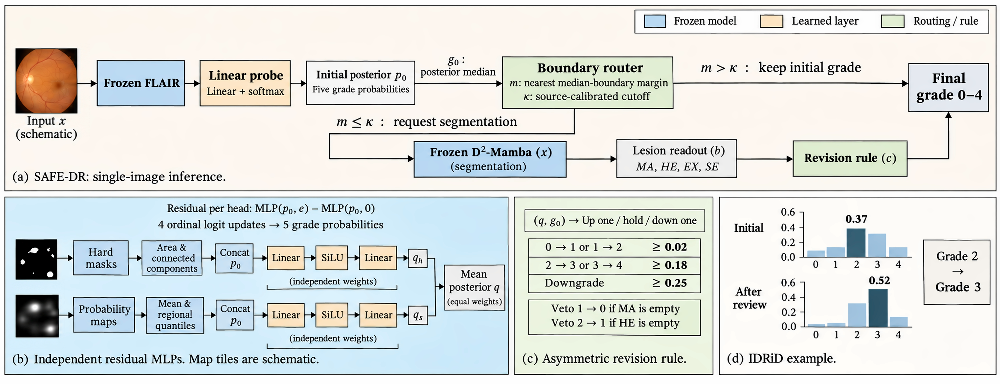

# SAFE-DR

**Selective Evidence Routing and Asymmetric Arbitration for Cross-Center DR Grading with Frozen Foundation Models**

[Try the interactive demo](https://wilop272.github.io/SAFE-DR/#try) · [Watch the four-case walkthrough](https://wilop272.github.io/SAFE-DR/#demo) · [View results and ablations](https://wilop272.github.io/SAFE-DR/#results)

When is a second look at a retinal photograph worth taking? SAFE-DR first assigns a diabetic retinopathy (DR) grade from 0 to 4 using the whole image. If the prediction falls near a grade boundary, it requests lesion segmentation and uses that evidence to keep the initial grade or move it by one.

## Try two cases

Open the demo, choose a **Cached case**, and click **Run SAFE-DR**. These two cases show both the benefit and the cost of selective review.

| Case | What to look for |
| --- | --- |
| **IDRiD #62** | The initial grade is 2. The router requests segmentation, and the lesion evidence supports an upgrade to the reference grade of 3. |
| **EyePACS #231** | The probe assigns grade 0 with probability 0.917 and skips segmentation. The reference grade is 1. This is a confident error that the router lets through. |

The browser recomputes each decision from cached features and trained weights. **Verify all 199 rows** checks the route and final grade against the archived Python outputs. In the video, the photographs are illustrative and the overlays come from a classical image filter. The numerical decisions come from the recorded study cases.

## How it works



1. A **linear probe** maps frozen FLAIR image features to five grade probabilities. The posterior median gives the initial grade.
2. The **boundary router** checks how close the cumulative probability is to 0.5 at the nearest grade boundary. A cutoff set on the source training folds determines whether to request segmentation.
3. For a routed image, **frozen D²-Mamba** provides lesion masks and probability maps. Two independently trained multilayer perceptrons read complementary summaries. One uses lesion areas and connected components. The other uses the strength and spatial distribution of the continuous responses. Their grade probabilities are averaged.
4. The **revision rule** accepts a one-grade change when its expected reduction in absolute grading error meets the threshold for that direction. An empty microaneurysm mask blocks a downgrade from 1 to 0. An empty haemorrhage mask blocks a downgrade from 2 to 1.

## Four-cohort results

Mean absolute error (MAE) measures the average distance from the reference grade. Lower is better. MMRDR is the held-out source fold. The other three cohorts evaluate transfer from MMRDR.

| Cohort | Images | FLAIR linear probe MAE | SAFE-DR MAE | Segmentation requests |
| --- | ---: | ---: | ---: | ---: |
| MMRDR | 1,550 | 0.2284 | **0.2129** | 451 |
| DeepDRiD | 328 | 0.4116 | **0.3659** | 180 |
| EyePACS | 3,329 | 0.2679 | **0.2559** | 696 |
| IDRiD | 405 | 0.2938 | **0.2840** | 162 |
| **Four cohorts** | **5,612** | **0.3004** | **0.2797** | **1,489** |

The mean MAE gives each cohort equal weight. Across individual images, the router requested segmentation for **1,489 of 5,612 (26.5%)**. That share ranged from **20.9% on EyePACS to 54.9% on DeepDRiD** with the same cutoff. Requesting segmentation for every image yielded a mean MAE of **0.2855**. The efficiency measure here is the number of tool requests in the replay.

These are retrospective results. EyePACS was represented in FLAIR pretraining. DDR was used to train the segmentation weights and is excluded from this comparison. [Evaluation details and limitations](https://wilop272.github.io/SAFE-DR/#limits)

## Run locally

The site is static HTML and JavaScript. With Git and Python 3 installed, run the following from a terminal.

```sh
git clone https://github.com/wilop272/SAFE-DR.git
cd SAFE-DR
python -m http.server 8000 --bind 127.0.0.1
```

Open [the local site](http://127.0.0.1:8000/). The [browser replay data](assets/replay.js) and [four-cohort results](assets/results.js) are included. The full-cohort Python evaluator uses a separate course code package. Its commands and expected outputs are listed in the [reproducibility section](https://wilop272.github.io/SAFE-DR/#repro).

## Team and credits

The Hong Kong Polytechnic University · BME34145 *AIDA for Health Care and Smart Ageing* · Group 16

XIA Wangding · Wang Xilin · Wang Guangzhen · Tian Li · Yang Haohan

Illustrative fundus photographs are credited to M. Häggström (CC0), the US National Eye Institute (public domain), and Hao et al. (CC BY 4.0).
